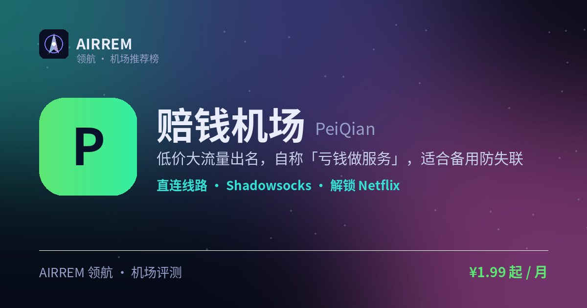

# 赔钱机场怎么样？2026 实测：极致低价备用

> 一句话总结：低价大流量出名，自称「亏钱做服务」，适合备用防失联

👉 **[赔钱机场 官网注册入口](https://s.rtxk.us/s/n9gmxan)** ｜ [完整评测与横向对比](https://555736.xyz/peiqian/)

---

## 基本信息

| 项目 | 内容 |
| --- | --- |
| 机场名称 | 赔钱机场 |
| 成立时间 | 2020 |
| 线路类型 | 全直连 / 部分中转 |
| 支持协议 | Shadowsocks / Trojan / VMess / VLESS / Hysteria2 |
| 流媒体解锁 | Netflix / ChatGPT / TikTok |
| 节点地区 | 香港 · 日本 · 美国 · 新加坡 等（含甲骨文云节点） |
| 计费方式 | 包月流量包 / 不限时 |
| 起步价格 | ¥1.99 / 月 |
| 推荐场景 | 想花小钱试水、当备用防失联 |

## 赔钱机场是什么

赔钱机场以「极致低价」为卖点，官方宣传「亏钱做服务」，主打大流量、低单价，套餐包装成「可乐」系列，圈内常归为「灵车」（便宜但有不确定性）类型。

## 线路 · 协议 · 解锁

全直连、无国内中转优化，速度取决于本地出口与运营商，通常联通/移动优于电信；含 0.1/0.01 超低倍率节点（部分甲骨文云套 CDN）；协议覆盖 SS/Trojan/VMess/VLESS/Hysteria2，电信用 Hysteria2 更好，建议用 Clash Meta / sing-box。

- 全直连，无国内中转
- 含 0.1 / 0.01 超低倍率节点
- 协议多，电信优先 Hysteria2

> 💡 流媒体解锁「随缘」，不建议作追剧主力。

## 赔钱机场 套餐价格

| 套餐 | 价格 | 说明 |
| --- | --- | --- |
| 中瓶可乐 | ¥1.99 | 月付起价 |
| 大瓶可乐 | ¥3.99 | 月付，另有半年/年更优惠 |
| 一会嗦一口 | ¥14.9 | 不限时 1000GB |
| 顶级王冠 | ¥688 | 永久 99999GB |

> 价格取自官网导航页 2026 活动价，以官网为准。

## 优点与缺点

**✅ 优点**

- 单价非常便宜
- 流量大，适合重度下载
- 含超低倍率节点进一步拉低单价
- 支持主流客户端与新协议

**⚠️ 缺点**

- 全直连无中转，晚高峰/电信体验有限
- 流媒体解锁随缘
- 机场行业存在跑路风险，建议先用月付或小额套餐验证稳定性，别一上来就大额年付。

## 适合谁 / 不适合谁

| 👍 适合 | 👎 不适合 |
| --- | --- |
| 预算有限、想要大流量的轻度用户 | 电信用户或对晚高峰速度要求高的人 |
| 需要备用防失联节点的老手 |  |

## 我们的结论

价格数一数二便宜、流量给得足，还有 0.1/0.01 超低倍率节点可薅；但全直连晚高峰与电信体验有限，建议只当备用、先月付小额验证。

## 常见问题

**Q：适合当主力吗？**

A：不建议，更偏低价备用/防失联，主力建议选专线或有中转优化的机场。

**Q：哪些用户体验更好？**

A：据反馈沿海移动/联通较好，电信及晚高峰需有心理预期。

## 同类机场推荐

拿不定主意？可以再看看这几家同类型的：

- **[Mitce](https://555736.xyz/mitce/)** — 性价比 / 新手主推，¥4 起
- **[良心云](https://555736.xyz/liangxin/)** — 低价尝鲜党，¥2 起
- **[一分机场](https://555736.xyz/yifen/)** — 低价大流量，¥2 起

全部 38 家机场的横向对比与选购方法论：**[信号塔 SignalTower · 机场大全](https://555736.xyz/airports/)**

---

数据更新：2026-07 ｜ 价格、套餐与优惠码以官网实时为准 ｜ 本仓库为第三方评测整理，与 赔钱机场 官方无隶属关系 ｜ 请遵守当地法律法规使用网络服务。

关键词：赔钱机场、低价机场、直连机场、备用机场、机场推荐
